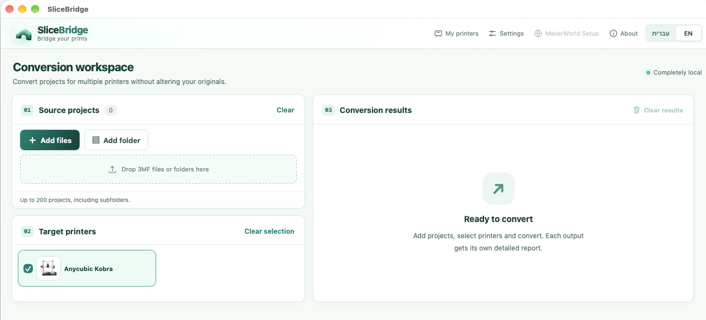
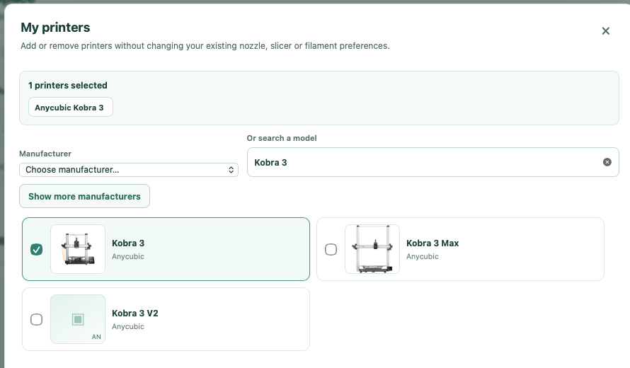
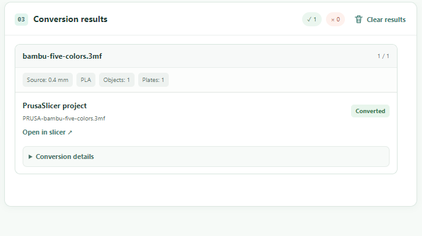

# SliceBridge

**Different slicers. One simple workflow.**

Bring your editable 3MF projects into another slicer workflow — **locally, without changing the originals**.

[**Download the experimental beta**](https://github.com/nocturney/slicebridge/releases/tag/v0.4.0-beta.5) · [See the app](#app-preview) · [English](#english) · [עברית](#hebrew)

## Inside SliceBridge

  

  
  

Real v0.4.0-beta.5 screenshots · Choose a printer on macOS · Inspect a successful conversion on Windows

## English

SliceBridge converts editable 3MF projects from **Bambu Studio**, **Orca-family slicers**, and **MakerWorld** into formats for printers with available installed slicer profiles, or into **PrusaSlicer projects**.

**Your workflow:** Add 3MF files or folders → choose your target → convert → open the resulting project in your slicer.

- **Locally processed.** Conversion runs on your computer, and your original 3MF files remain unchanged.
- **Keep your project editable.** Geometry and source color/material channels are carried over where the selected conversion supports them; batch conversion is available.
- **Review before printing.** Check the target printer/nozzle, filament or tool mapping, purge and prime tower settings, and layer preview in the destination slicer. SliceBridge does not automatically send prints.

**Get started:** [Windows x64 — SliceBridge.exe](https://github.com/nocturney/slicebridge/releases/download/v0.4.0-beta.5/SliceBridge.exe) · [macOS Apple Silicon — SliceBridge.app ZIP](https://github.com/nocturney/slicebridge/releases/download/v0.4.0-beta.5/SliceBridge-macOS-Apple-Silicon.zip) · [All releases and checksums](https://github.com/nocturney/slicebridge/releases)

*Experimental beta.* Windows is unsigned and macOS is not notarized; see the [release notes](https://github.com/nocturney/slicebridge/releases/tag/v0.4.0-beta.5) for installation guidance and limitations.

## עברית

SliceBridge מחבר בין סלייסרים: ממיר פרויקטי **3MF הניתנים לעריכה** מ־**Bambu Studio**, מסלייסרים ממשפחת **Orca** ומ־**MakerWorld** למדפסות שיש להן פרופילי סלייסר מקומיים זמינים, וגם לפרויקטי **PrusaSlicer**.

**ארבעה צעדים פשוטים:** מוסיפים קבצים או תיקיות ← בוחרים מדפסת או יעד ← ממירים ← פותחים בסלייסר היעד ובודקים את התוצאה.

- **עבודה מקומית:** קובצי המקור נשארים ללא שינוי.
- **פרויקט שניתן להמשיך לערוך:** הגאומטריה וערוצי הצבע והחומר נשמרים בהתאם ליכולות מסלול ההמרה. אפשר להמיר כמה פרויקטים יחד.
- **הכנה ידנית להדפסה:** בודקים את הגדרות המדפסת והדיזה, מיפוי החומרים, מגדל הניקוי ותצוגת השכבות בסלייסר. SliceBridge אינו שולח הדפסות אוטומטית.

**הורדת הבטא:** [Windows](https://github.com/nocturney/slicebridge/releases/download/v0.4.0-beta.5/SliceBridge.exe) · [Mac עם Apple Silicon](https://github.com/nocturney/slicebridge/releases/download/v0.4.0-beta.5/SliceBridge-macOS-Apple-Silicon.zip) · [כל הגרסאות והחתימות](https://github.com/nocturney/slicebridge/releases)

זו **גרסת בטא ניסיונית**. ב־Windows התוכנה אינה חתומה וב־macOS אינה מאושרת ב־notarization. פרטים והוראות בעמוד [הגרסה](https://github.com/nocturney/slicebridge/releases/tag/v0.4.0-beta.5).

---

**Source / קוד:** [GitHub](https://github.com/nocturney/slicebridge) · **License / רישיון:** [GPL-3.0-only](LICENSE) · [Report an issue / דיווח על תקלה](https://github.com/nocturney/slicebridge/issues)
